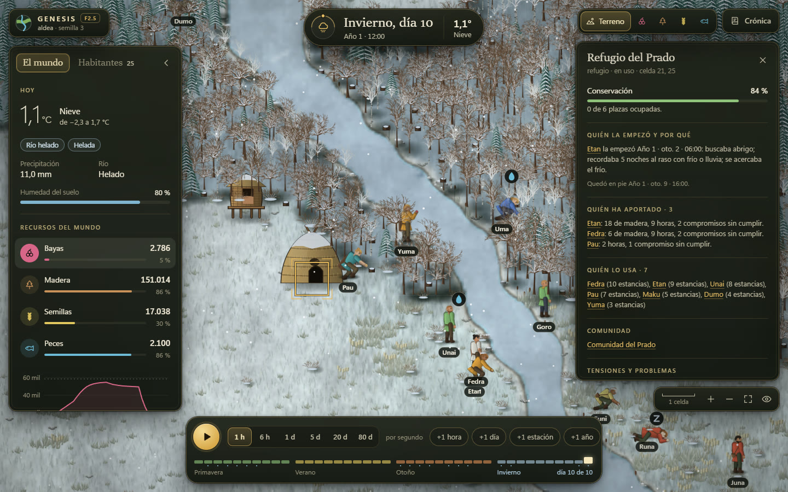
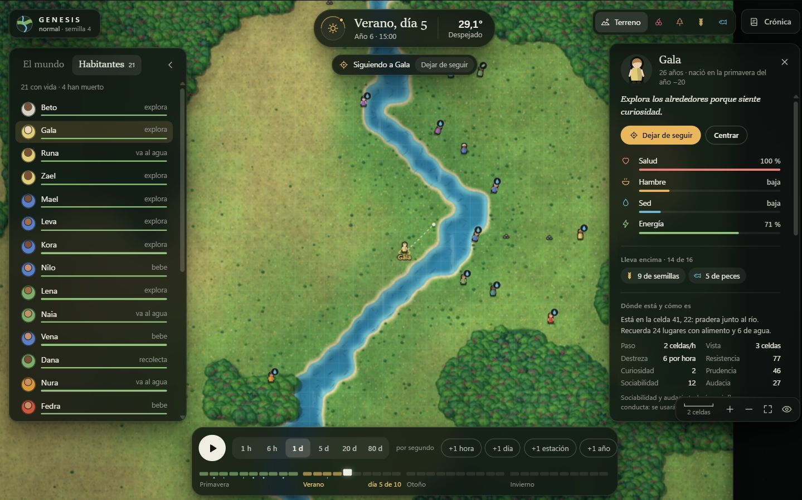
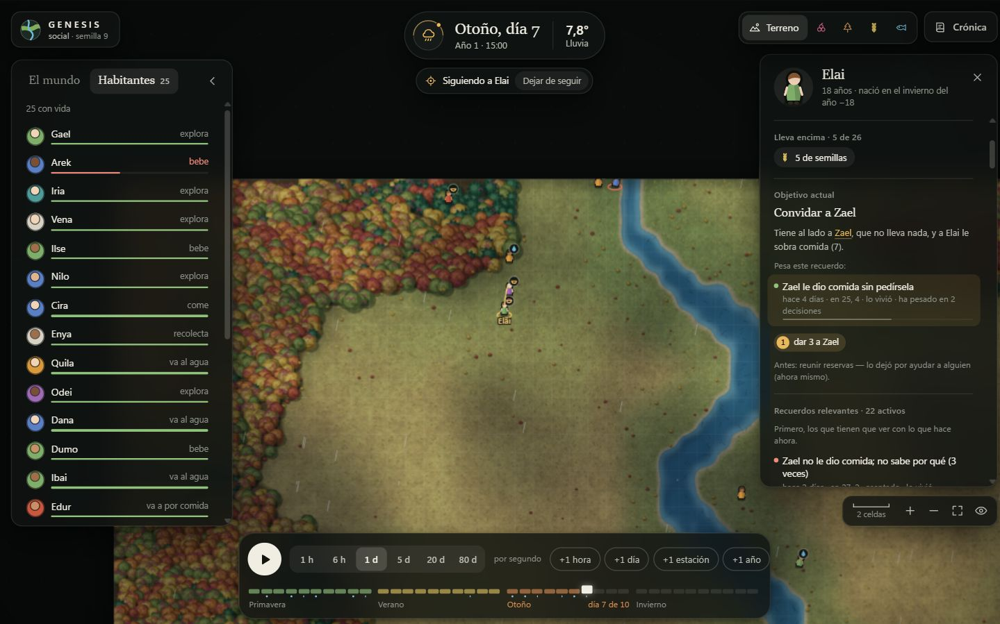

# GENESIS 0.4 · Vidas y generaciones

Abre **iniciar.bat** y usa **Intervenir** para elegir una celda, revisar el efecto y confirmar. **Historias** reúne las consecuencias de cada intervención, promesa y crianza. En la ficha de un habitante, **Familia y vínculos** muestra sus razones, sus maestros y el botón para añadirlo a favoritos.

Las partidas nuevas utilizan F4. Para llevar una partida anterior a esta fase en una copia, ejecuta `py -3 ejecutar.py ampliar NOMBRE` y abre `iniciar.bat NOMBRE-f4`. Las vidas nuevas comienzan en la primera hora posterior a la copia. [Guía de F4, pruebas, capturas y resultados](docs/F4-ESTADO.md).

## El mundo de las fases anteriores

Un mundo determinista habitado por 25 individuos autónomos. Exploran, recogen
alimento, comen, beben, descansan, envejecen y pueden morir (F1). Desde F2,
además:

- **Recuerdan** lo que les pasa: dónde hallaron alimento o lo encontraron
  agotado, dónde pasaron sed, hambre o frío, quién les ayudó y quién no.
- **Creen** cosas sobre lugares y personas, con antigüedad, procedencia y
  confianza. Pueden estar equivocados, y se corrigen cuando lo comprueban.
- **Persiguen objetivos** con planes cortos, que solo abandonan por algo más
  urgente, y dejan anotado por qué deciden lo que deciden.
- **Se tratan entre sí**: piden comida, la dan o la niegan, y se indican
  lugares. De esos hechos nacen relaciones dirigidas, que cambian lo que
  harán la próxima vez.

Desde F3, además:

- **Levantan lugares compartidos.** Talan madera de verdad (sale de las
  existencias del bosque), la cargan, la llevan y trabajan en la obra hasta
  terminar un **refugio** (abriga y deja descansar mejor a 6 personas) o un
  **depósito** (guarda hasta 80 unidades de comida para quien la necesite).
  Las obras se paran, se abandonan y se reanudan; lo terminado se estropea y
  se repara.
- **Se comprometen** a traer madera o a trabajar, y otros juzgan si cumplen
  según lo que ven (no es lo mismo faltar por una urgencia que sin motivo).
- **Se cuentan dónde están los lugares** y lo comprueban: lo que A vivió llega
  a B como información con origen y confianza, y cambia lo que B decide.
- **Forman comunidades** alrededor de los lugares que han levantado o usado
  juntos; cada persona decide si se une, se aleja, vuelve o se va según lo que
  ha vivido allí. Proponen y aceptan o rechazan **acuerdos** sencillos
  (reserva mínima, prioridad para quien está en apuros).

Todo ocurre en el motor con algoritmos convencionales: no hay modelos de
lenguaje, y ningún texto del visor inventa nada. Cada frase que se lee sale de
un dato guardado. Estado detallado de la entrega: [docs/F3-ESTADO.md](docs/F3-ESTADO.md)
y su corrección [docs/F3.1-ESTADO.md](docs/F3.1-ESTADO.md) (cesiones de sitio en refugios
con una razón y una causa fiel). F2: [docs/F2-ESTADO.md](docs/F2-ESTADO.md).

F2.5 no cambia el motor: rehace el dibujo del mundo, de las personas y de la
interfaz (volumen, luz, estaciones, poses, retratos, paneles) y mide su
fluidez. Detalle, capturas de antes y después y medidas en
[docs/F2.5-ESTADO.md](docs/F2.5-ESTADO.md).

## Requisitos

- Windows 10 u 11.
- Python 3.10 o posterior (probado con 3.14). No hace falta instalar nada más:
  GENESIS solo usa la biblioteca estándar de Python.

## Abrir el visor

Haz doble clic en **`iniciar.bat`**. Se abre una ventana de consola y, en tu
navegador, la dirección `http://127.0.0.1:8765/`.

- Sin indicar nada abre la partida más reciente que use las reglas actuales
  (F4, vidas y generaciones); si no hay ninguna, crea una con la semilla 1.
- Las partidas anteriores no se tocan. Si `semilla-1` ya existe con las reglas
  de F2, el mundo nuevo se guarda como `semilla-1-comunidad`; si es de F1, como
  `semilla-1-sociedad`; si era de F0, como `semilla-1-habitado`. Para abrir una
  partida antigua tal cual, indica su nombre: `iniciar.bat semilla-1`. Conserva
  sus reglas y su historia.
- Para seguir una partida habitada anterior a F4 con las reglas nuevas, haz una copia
  ampliada: `py -3 ejecutar.py ampliar semilla-1` (véase «Partidas de fases
  anteriores»).
- Para cerrar, pulsa `Ctrl+C` en la ventana de consola: la partida se guarda.
  Si cierras la ventana con la X se conserva hasta el inicio del último día
  simulado.

Desde una terminal, en esta carpeta:

```bat
iniciar.bat --semilla 42
```

abre (o crea) la partida `semilla-42`. La misma semilla produce siempre el
mismo mundo y la misma historia.

## Usar el visor

El mundo ocupa toda la ventana y la interfaz flota encima.



- **Moverse por el mapa.** Arrastra para desplazarte y usa la rueda para
  acercarte o alejarte (doble clic también acerca). Abajo a la derecha están
  los botones de zoom, el de ver el mundo entero y la escala. Al acercarte
  aparecen los detalles: árboles sueltos, bayas, espigas, flores y peces.
- **Tiempo.** En el muelle inferior: el botón redondo pone el mundo en marcha
  o lo pausa (también la barra espaciadora); al lado, la velocidad (de 1 hora
  a 80 días simulados por segundo) y los avances exactos de una hora, un día,
  una estación o un año. Los saltos largos muestran progreso, permiten cancelar
  y ofrecen un resumen de lo ocurrido en todo el intervalo. La tira muestra
  el día del año; un punto bajo un
  día indica precipitación.
- **Fecha y cielo.** Arriba, en el centro. El anillo es un reloj de 24 horas:
  el astro recorre el arco superior durante el día.
- **Capas.** Arriba a la derecha. «Terreno» es el mapa pintado; cada recurso
  tiene una capa de datos en la que un círculo por celda indica cuánto queda
  respecto a su capacidad. Muy de cerca se lee la cifra exacta.
- **El mundo.** Panel plegable de la izquierda: el tiempo de hoy, el total de
  cada recurso y su evolución. Al pulsar un recurso se abre su capa.
- **Inspeccionar una celda.** Haz clic en el mapa: se abre una ficha con el
  bioma, la fertilidad y los recursos de esa celda. Con las flechas pasas a
  las celdas vecinas y con Esc la cierras.
- **Inspeccionar un refugio o un depósito.** Haz clic en cualquier parte de su
  dibujo: su ficha dice en qué estado está (madera y trabajo de la obra,
  conservación, plazas ocupadas o lo que guarda), quién lo empezó y por qué,
  quién aportó y qué, quién lo usa, a qué comunidad pertenece, sus acuerdos, sus
  tensiones (compromisos sin cumplir, gente que se quedó sin sitio, depósito
  vacío) y su historia. Desde ahí se abre la ficha de la **comunidad**:
  miembros con lo que ha puesto cada uno, quién se fue y por qué, acuerdos y
  lo que explica su historia.
- **Crónica.** El botón de arriba a la derecha abre el registro de eventos.
  «Hitos» muestra solo los cambios (estaciones, sequías, hielo); al pulsar un
  acontecimiento se ve por qué ocurrió y qué provocó. Los hitos nuevos se
  anuncian además sobre el mapa.

Teclas: espacio (marcha y pausa), `+` y `-` (zoom), `0` (mundo entero),
flechas (mover la celda elegida o la vista), Esc (cerrar).

### Observar a los habitantes

- La pestaña **Comunidad** de la ficha de una persona dice a qué comunidades
  pertenece (y a cuáles perteneció), su compromiso actual, lo que ha llevado,
  trabajado, guardado y sacado en cada lugar, los acuerdos que conoce y los
  lugares que cree conocer, con el dato real aparte.
- La pestaña **Habitantes** muestra vivos y fallecidos. Selecciona a alguien
  desde la lista o haciendo clic sobre su figura en el mapa.
- Su ficha muestra edad, actividad y motivo, necesidades, inventario,
  capacidades y acontecimientos. **Ver anteriores** recorre la historia completa
  en páginas de 200 sucesos; el registro no se recorta.
- **Seguir** mantiene la cámara sobre esa persona. Seleccionar otra transfiere
  el seguimiento y actualiza el nombre; seleccionar a un fallecido lo detiene.
  Puedes dejar de seguir o arrastrar la vista. Si muere quien sigues, se avisa.
- Los acontecimientos enlazan con su causa y con los individuos relacionados.
- El botón del ojo oculta/restaura paneles; `H` también alterna la vista limpia
  con el mapa enfocado. `S` alterna el seguimiento del individuo seleccionado.
- Un año del modelo son **40 días / 960 horas**. Los saltos procesan todas las
  horas: no cambian únicamente la fecha. La velocidad real depende del equipo.



### Entender una vida: qué recuerda, qué cree y qué pretende

La ficha de un habitante tiene cuatro bloques nuevos:

- **Objetivo actual.** Qué intenta conseguir, por qué (la necesidad, la
  creencia en la que se apoya y los recuerdos que han pesado) y los pasos de su
  plan, con el paso en curso resaltado. Si eligió un lugar distinto del que le
  quedaba mejor por algo que recuerda, lo dice. Debajo, qué hacía antes y por
  qué lo dejó. Estas razones se guardan en el momento de decidir; el visor solo
  las traduce.
- **Recuerdos relevantes.** Primero los que tienen que ver con lo que hace
  ahora. Cada recuerdo indica cuándo fue, dónde, con quién, si lo vivió o se lo
  contaron y cuántas decisiones ha influido. Al pulsarlo se abre el
  acontecimiento que lo originó, con su causa y sus consecuencias. La memoria
  activa es limitada: lo olvidado sigue en «Su vida» y en la crónica.
- **Lo que cree.** Los lugares con alimento que ha visto (con su antigüedad),
  los que le han indicado y aún no ha comprobado (con quién se lo dijo), y los
  que vio vacíos. La etiqueta punteada **«en el mundo»** marca el dato real
  cuando no coincide con lo que cree: es información para ti, no para el
  personaje. «Señalar en el mapa» dibuja sus creencias: círculo continuo si lo
  vio, discontinuo si se lo contaron, aspa si lo vio vacío.
- **Personas que conoce.** Lo que piensa de cada una y por qué (le dio, le
  negó, le indicó bien o mal, se le adelantó). La confianza es dirigida: la
  otra persona puede pensar distinto. Si alguien ha muerto y él no lo sabe, se
  indica como dato del mundo.

En el mapa, un trato en curso se ve como un arco o un cerco que une a las dos
personas, con un cuenco sobre quien pide o da y tres puntos sobre quien habla.

En la **crónica**, el filtro «Tratos» muestra los intercambios entre personas,
sus comprobaciones y los viajes en balde relacionados con la búsqueda de alimento.
Las repeticiones rutinarias de un mismo día (indicaciones, peticiones, viajes
en balde) se agrupan en una línea que se despliega al pulsarla. Desde el
detalle de un trato se llega a las dos personas y a lo que provocó. Sobre el
mapa solo se anuncia la primera vez que algo ocurre entre dos personas.

Los resúmenes de los saltos cuentan todas las entregas, peticiones,
indicaciones y viajes en balde del intervalo, sin recortar, y también lo
colectivo: obras empezadas, terminadas, paradas y abandonadas, madera llevada,
reparaciones, estancias a cubierto, veces sin sitio, lo guardado y lo sacado,
compromisos sin cumplir, comunidades formadas, incorporaciones, salidas y
acuerdos. El filtro «Comunidades» de la crónica muestra solo esos sucesos.



Las [cadenas causales comprobadas](docs/F2-CADENAS.md) explican cómo repetir
la devolución de ayuda de la captura, con sus acontecimientos de origen.

### Qué es dato y qué es dibujo

El mapa se pinta a partir de los datos del motor y no los modifica:

- El número de árboles en pie, de racimos de bayas, de espigas y de peces
  sale de las existencias reales de cada celda.
- El verde de la pradera sigue a la fertilidad y a la cercanía del río; los
  colores cambian con la estación; la lluvia, la nieve, la escarcha, la sequía
  y el hielo del río responden al estado del clima.
- Las fronteras suaves entre bosque, pradera y río son una interpretación
  del dibujo: pueden desviarse hasta un tercio de celda. La celda que se
  inspecciona es siempre la celda exacta del motor, y su marco se dibuja
  cuadrado.
- La luz del día sigue la hora simulada. A partir de un día por segundo se
  usa una luz media para que no parpadee.
- Cada persona tiene un aspecto fijo que sale de sus datos (piel, pelo, ropa)
  y de su identificador (peinado, barba, adorno): es el mismo en el mapa, en
  la lista y en el retrato de la ficha. Su pose sale de la actividad que dice
  el motor (caminar, recoger, pescar, beber, comer, dormir, dar, pedir,
  hablar); quien recibe una entrega tiende las manos mientras el otro da. No
  hay gestos inventados.
- Dos personas que tratan se acercan una a otra para verse de frente, pero
  sin salir nunca de la celda en la que están de verdad.
- Refugios y depósitos se dibujan desde sus datos: estacas al empezar, un
  palo por cada parte de madera incorporada, la cubierta crece con las horas
  de trabajo, la pila de troncos es la madera entregada que aún no se ha usado,
  los huecos son la conservación perdida, y lo que asoma por la boca del
  depósito es lo que guarda. De noche solo hay luz en la puerta y humo si hay
  alguien dentro, con una marca por persona. Quien está a cubierto no se dibuja
  (está dentro); si lo eliges, aparece en la puerta. Quien lleva madera la
  carga a la espalda, y talar, construir y guardar tienen su postura.
- Más allá del borde, el terreno se prolonga reflejado, borroso y en bruma:
  no es mundo, no se puede elegir y no contiene nada.

## Otras órdenes

```bat
py -3 ejecutar.py nueva --semilla 7 --nombre valle
py -3 ejecutar.py simular valle --dias 400
py -3 ejecutar.py verificar valle
py -3 ejecutar.py listar
py -3 ejecutar.py nueva --semilla 7 --nombre vacio --habitantes 0
py -3 ejecutar.py nueva --semilla 7 --nombre escaso --abundancia 0.3
py -3 ejecutar.py nueva --semilla 7 --nombre como-f2 --reglas 2
py -3 ejecutar.py nueva --semilla 7 --nombre como-f1 --reglas 1
py -3 ejecutar.py ampliar semilla-1
```

- `simular` avanza una partida sin interfaz e informa del tiempo real empleado.
- `verificar` regenera el mundo desde la semilla, repite la historia y
  comprueba que coincide exactamente con lo guardado.

Las partidas son archivos SQLite en la carpeta `partidas/`, uno por mundo.

En un mundo abundante casi nadie necesita pedir: el trato se reduce a
indicarse lugares y a alguna petición en invierno. Para ver más ayuda,
negativas, reciprocidad y competencia, abre un mundo escaso:

```bat
iniciar.bat --semilla 9 --abundancia 0.3
```

Se guarda aparte, como `semilla-9-ab30`.

### Partidas de fases anteriores

Cada partida guarda la versión de sus reglas de conducta y se reproduce
siempre con ellas:

| Partida | Reglas | Qué ocurre al abrirla |
| --- | --- | --- |
| F0, sin habitantes | — | Se abre igual que siempre, sin habitantes. |
| F1 | 1 | Se abre con las reglas de F1: sin memoria ni tratos. `verificar` sigue dando reproducción exacta. |
| F2 | 2 | Memoria, creencias, planes y tratos, sin construcciones ni comunidades. |
| F3 | 3 | Todo lo anterior más obras, refugios, depósitos, compromisos, comunidades y acuerdos. Las creadas antes de F3.1 conservan el criterio de cesión de F3. |
| F3.1 | 3 (corrección 1) | F3 con el criterio de cesión de sitio corregido. Las partidas de esta fase conservan su criterio. |
| F4 | 4 | Vidas, generaciones, intervenciones, reflexión local y promesas. Fase de las partidas nuevas. |

La orden de ampliación crea NOMBRE-f4. El motor guarda las horas de activación de sociedad, comunidad, corrección de cesiones y vidas por separado. La reproducción recorre cada etapa y aplica las órdenes externas en el orden en que ocurrieron.

## Pruebas

Doble clic en **`probar.bat`**, o:

```bat
py -3 -m unittest discover -s pruebas -t .
```

Las regresiones del estado de la interfaz se ejecutan aparte, con Node.js si
está instalado (no hace falta para jugar):

```bat
node --test pruebas/test_interfaz.mjs
```

## Cómo está organizado

```
genesis/
  motor/      mundo determinista: no toca disco ni interfaz
    azar.py        azar sin estado: f(semilla, flujo, claves)
    calendario.py  tick -> hora, día, estación, año
    config.py      todos los parámetros de un mundo
    terreno.py     generación del mapa
    clima.py       parte diario, sequía, hielo del río
    recursos.py    existencias por celda, libro de cuentas, extracción
    habitantes.py  cuerpo, percepción y acciones de cada individuo
    rutas.py       caminos por tierra
    decisiones.py  intenciones y política de F1 (reglas 1)
    mente.py       recuerdos, creencias recibidas y relaciones; olvido
    sociedad.py    lo que se aprende al observar y los tratos entre personas
    planes.py      política de F2 y F3: objetivos, planes y razones
    comunidad.py   F3: construcciones, obras, compromisos, refugio, depósitos, lugares, comunidades, acuerdos
    obras.py       F3: la parte de la política que decide obras, resguardo, reservas, informes y acuerdos
    eventos.py     registro de eventos con hash encadenado
    sistemas.py    contrato que cumple cada sistema
    mundo.py       estado completo y avance tick a tick
  almacen/    partidas en SQLite y verificación de reproducción
  sesion.py   una partida en marcha: pausa, velocidad, guardado
  visor/      servidor HTTP local y página web
    estatico/mapa.js        dibujo del mundo (terreno, vegetación, clima, zoom)
    estatico/arte.js        árboles por especies, hierba, rocas y juncos pintados por código, en atlas por estación
    estatico/figuras.js     personas: aspecto fijo, esqueleto, poses, sprites y retrato
    estatico/app.js         interfaz: paneles, tiempo, crónica, inspección
    estatico/habitantes.js  lista, ficha, seguimiento y saltos
    estatico/mente.js       objetivo, recuerdos, creencias y conocidos, en palabras
    estatico/construcciones.js  refugios y depósitos dibujados desde sus datos
    estatico/lugares.js     frases de F3, fichas de construcción y comunidad, pestaña «Comunidad»
  cli.py      línea de comandos
pruebas/      pruebas automáticas
herramientas/ medidas: rendimiento del motor (medir_f2.py), fluidez del visor (medir_fluidez.mjs) y revisión de mundos libres de F3 (revisar_f3.py)
```

Cada capa solo conoce a las anteriores: el motor no importa nada del almacén,
de la sesión ni del visor, y el visor solo habla con la sesión.

### El modelo, en breve

- **Tiempo.** Un tick es una hora. El año está comprimido: 4 estaciones de 10
  días (960 horas).
- **Mapa.** 64×64 celdas. Un río cruza de norte a sur; el 45 % de la tierra es
  bosque y el resto pradera. Cada celda tiene una fertilidad que modula su
  capacidad.
- **Clima.** A las 00:00 de cada día se calcula su parte: temperatura (ciclo
  anual más una anomalía que arrastra la del día anterior), precipitación y
  humedad del suelo. De él salen tres estados: helada, sequía y río helado.
- **Recursos.** Bayas y madera en el bosque, semillas en la pradera, peces en
  el río. A las 23:00 se aplica el balance del día: crecimiento logístico
  según estación, humedad y hielo; pérdidas por estación y heladas.
- **Conservación.** Las existencias son enteros (milésimas de unidad) y cada
  cambio se anota en un libro. Cada día se comprueba que
  `total = inicial + crecimiento − pérdida − extracción` y que ninguna celda
  sale de `[0, capacidad]`. Si falla, el motor se detiene.

Los parámetros están en `genesis/motor/config.py`. Son un modelo sencillo para
dar estaciones reconocibles, no una simulación científica.

### Memoria, creencias y trato, en breve

- **Recuerdo.** Guarda qué pasó, cuándo, dónde, con quién, lo bueno o malo que
  fue, su importancia, si lo vivió o se lo contaron y los identificadores de
  los acontecimientos que lo originaron. Pierde fuerza cada día; las vivencias
  parecidas (misma clase y misma persona o zona) se funden en un recuerdo
  consolidado, que dura el triple. El repaso diario reduce la memoria a 32;
  entre repasos puede crecer, con un límite de seguridad de 68 comprobado por
  el motor. El olvido es determinista y no toca el registro de la partida.
- **Creencia.** Un lugar visto vale por lo que había y por su antigüedad. Un
  lugar que le han indicado vale menos: depende de cuánto se fía de quien se
  lo dijo, de su prudencia y de si es de oídas. Al tenerlo a la vista se
  comprueba, y la confianza en quien lo dijo sube o baja; una noticia vieja
  que ya no es cierta se disculpa.
- **Objetivo y plan.** Beber, comer, ponerse a cubierto, descansar, contestar a
  quien pide, ayudar, reunir reservas, contar un lugar, explorar. Cada uno
  tiene una prioridad; solo interrumpe al actual otro de prioridad mayor que
  pueda llevarse a cabo. El plan es una lista de acciones del motor con sus
  condiciones; si una deja de cumplirse (la fuente se agotó, la persona se
  fue) el plan se rehace y queda anotado por qué.
- **Tratos.** Pedir, dar, negar y contar exigen estar al lado y cuestan una
  hora. Una petición se resuelve en el siguiente turno de quien la recibe; si
  hay varias, atiende una y las demás quedan sin respuesta, con la razón
  visible. Una entrega es atómica y nunca supera lo que cabe. La gratitud
  depende de la necesidad real de quien recibe: un regalo innecesario no
  cambia nada, de modo que no sirve regalarse comida en círculo.
- **Relaciones.** Dirigidas y solo por experiencia directa: no hay reputación
  global. Quien recibe una negativa juzga con lo que ve: si el otro no llevaba
  nada o estaba en apuros, no se lo toma a mal; si iba cargado, sí; si no sabe
  por qué, lo deja en duda.
- **Rasgos.** Sociabilidad: pide antes, da y cuenta con más facilidad, busca
  dormir cerca de quien confía. Prudencia: guarda más para sí y se fía menos
  de lo que le cuentan. Curiosidad: va a comprobar lo que le han dicho.
  Audacia: pide a desconocidos y teme menos los malos recuerdos. Ninguno
  obliga: la necesidad propia o una deuda pueden más.

Los parámetros están en `ConfigMente` (`genesis/motor/config.py`).

### Eventos

| Tipo | Cuándo | Causa |
| --- | --- | --- |
| `mundo.creado` | tick 0 | — |
| `tiempo.anio`, `tiempo.estacion` | al empezar | — |
| `clima.dia` | 00:00 de cada día | — |
| `clima.sequia_inicio`, `clima.sequia_fin` | al cruzar el umbral de humedad | el parte del día |
| `rio.helado`, `rio.deshelado` | al cruzar el umbral de temperatura | el parte del día |
| `recursos.balance` | 23:00 de cada día | el parte del día |
| `recurso.extraido` | orden `extraer` | la que indique quien ordena |
| `recurso.agotado` | una extracción deja la celda a cero | la extracción |
| `recurso.recuperado` | la celda vuelve a tener una unidad | el agotamiento |
| `habitante.pide` | pide comida a quien tiene al lado | su episodio de hambre, si lo hay |
| `habitante.da` | entrega comida (pedida o no) | la petición; si no la hubo, la ayuda que recuerda o el hambre del otro |
| `habitante.niega` | no da lo pedido; lleva la razón | la petición |
| `habitante.rehusa` | no acepta un ofrecimiento (detalle) | — |
| `habitante.cuenta` | indica un lugar con alimento o agua | la petición, o la ayuda que recuerda |
| `habitante.comprueba` | ve con sus ojos el lugar indicado | la indicación |
| `habitante.viaje_fallido` | iba a por alimento y ya no quedaba | la indicación, si iba por ella |
| `habitante.fuente_agotada` | lo mismo en un trayecto corto (detalle) | — |
| `sociedad.activada` | una partida de F1 ampliada activa las reglas 2 | — |
| `comunidad.reglas_activadas` | una partida ampliada activa las reglas 3 | — |
| `obra.iniciada` | alguien empieza un refugio o un depósito; lleva sus razones | la vivencia que pesó, si la hay |
| `proyecto.compromiso`, `proyecto.compromiso_dejado` | se compromete a traer madera, trabajar o reparar; lo deja (urgencia, caducado, no pudo, muerte) | la obra |
| `obra.aporte`, `obra.trabajo`, `obra.terminada` | lleva madera, trabaja una tanda, la obra queda en pie | el compromiso o la obra |
| `obra.suspendida`, `obra.abandonada`, `obra.reanudada` | días sin avanzar; nadie vuelve; alguien la retoma | la obra |
| `estructura.deterioro`, `estructura.ruina`, `estructura.reparada` | pierde conservación; queda en ruina; alguien la repara | — |
| `refugio.estancia`, `refugio.sin_sitio` | pasa horas a cubierto; no cabe | lo que le contaron del refugio, si fue por eso |
| `refugio.cede_sitio` | cede su sitio a quien llega mucho peor, con peligro fuera (F3.1) | su aceptación del acuerdo de prioridad, o la ayuda que recuerda de quien llega |
| `refugio.criterio_cesion` | una copia ampliada de una F3 empieza a usar el criterio de F3.1 | — |
| `deposito.guarda`, `deposito.retira`, `deposito.vacio` | guarda comida; la saca (con o sin respetar la reserva acordada); lo encuentra vacío | — |
| `lugar.informa`, `lugar.comprobado` | cuenta a otra persona dónde está un lugar o cómo le fue; quien lo oyó lo comprueba | lo vivido o lo que le contaron |
| `comunidad.formada`, `union`, `alejamiento`, `vuelve`, `salida`, `estado`, `disuelta` | cambios de pertenencia decididos por cada persona | lo vivido en sus lugares |
| `acuerdo.propuesto`, `acuerdo.aceptado`, `acuerdo.rechazado` | un acuerdo del catálogo se propone y cada persona lo acepta o no | la propuesta |

Los eventos de F1 (`habitante.aparece`, `hallazgo`, `viaje`, `sed_grave`,
`hambre_grave`, `se_repone`, `intemperie`, `sobrevive`, `muere`) no cambian.
En los tratos, `id` es quien actúa y `a` la otra persona; ambos los ven en su
historia.

### Añadir un sistema en fases siguientes

1. Escribir una clase que cumpla el contrato de `motor/sistemas.py`
   (`iniciar`, `al_tick`, `exportar`, `importar`, `verificar`).
2. Añadirla a `self.sistemas` en `Mundo.__init__`, en el orden en que debe
   ejecutarse.
3. Usar flujos de azar propios (`flujo("agentes.loquesea")`): así no se
   alteran los números que ya reciben clima y terreno.

Su estado se guarda bajo su `nombre` y entra en los hashes de verificación.
Un sistema nuevo necesita compatibilidad explícita o una migración: el motor
comprueba los sistemas guardados. Las partidas F0 se abren sin habitantes y
conservan su historia.

### Sustituir la política de decisiones

La política es un objeto con un método `decidir(percepcion) -> Intencion` (y,
opcionalmente, `aceptar(percepcion, de, cantidad) -> int` para los
ofrecimientos). Recibe solo lo que la persona percibe, recuerda y cree; no
tiene acceso al mundo. Devuelve una acción del catálogo cerrado y el motor la
valida: una intención imposible se rechaza y queda registrada. Para probar otra
política basta con `mundo.habitantes.politica = MiPolitica()`. La deliberación
con un modelo de lenguaje, cuando llegue, entrará por aquí.

## Qué no hay todavía

- Conversaciones, lenguaje, engaño deliberado, reputación transmitida,
  parentesco, propiedad privada, intercambio o reparto formal de tareas. El
  trato se limita a pedir, dar, negar, contar un lugar, comprometerse con una
  obra y proponer un acuerdo del catálogo.
- Otras construcciones (solo refugio y depósito), herramientas, fuego, ropa o
  agricultura. Religión, normas inventadas o líderes: no se generan.
- Nacimientos ni nuevas generaciones: los fallecidos no se reemplazan.
- Modelos de lenguaje. Los tiempos de inferencia del documento de arquitectura
  son estimaciones sin medir; se medirán cuando se integre la deliberación.
- Fauna, enfermedades, agricultura, materiales no renovables.
- Intervenciones del experimentador y bifurcación de historias (F6). Se
  conservan instantáneas al inicio de cada estación, pero todavía no hay
  ninguna función que parta de ellas.

## Límites conocidos

- **En la abundancia hay poco trato.** Con comida de sobra casi nadie pide: es
  el resultado del modelo, no un fallo. La reciprocidad (devolver una ayuda)
  es posible y está probada, pero en los mundos libres observados es rara:
  quien pasa necesidad suele seguir pasándola.
- **Conocen el terreno.** Saben dónde hay bosque, pradera y río aunque no
  hayan estado; lo que no conocen son las existencias de alimento ni a las
  personas.
- **Una hora por paso.** Las decisiones y los tratos se resuelven hora a hora.
- **Las entregas son solo de comida.** Guardar para otros existe solo a través
  del depósito común.
- **Los refugios no tienen agua.** En inviernos muy duros quien está a cubierto
  tiene que salir a beber al río y cruzar el raso helado; es la causa de la
  mayoría de las muertes que quedan (véase docs/F3-ESTADO.md).

- **Determinismo.** Está comprobado en este equipo y entre procesos distintos
  de Python. No está comprobado entre sistemas operativos o versiones de
  Python: el clima usa funciones matemáticas cuyo último decimal podría
  variar; `verificar` lo detectaría.
- **Sin consumo, los recursos se saturan.** En un mundo creado sin habitantes las
  existencias oscilan con las estaciones cerca de su capacidad. Es lo esperado
  en F0.
- **Un visor por partida.** No abras la misma partida en dos consolas a la vez.
- **Tipografía.** El visor usa fuentes de Windows (Sitka y Segoe UI) para no
  depender de internet; en otro sistema se sustituyen por las equivalentes.
- **Mapa.** El dibujo no representa relieve, nieve acumulada ni caminos:
  el motor no los simula.
- **Fluidez.** El paisaje se repinta solo cuando cambia algo visible, y en
  segundo plano, repartido en varios cuadros; las personas se guardan como
  sprites. Con el tiempo en marcha no hay tareas largas en el hilo principal.
  El caso más exigente es un zoom continuo muy rápido, que baja la cadencia
  media. Medido con una RTX 5070; no está medido en equipos lentos (véase
  docs/F2.5-ESTADO.md).
