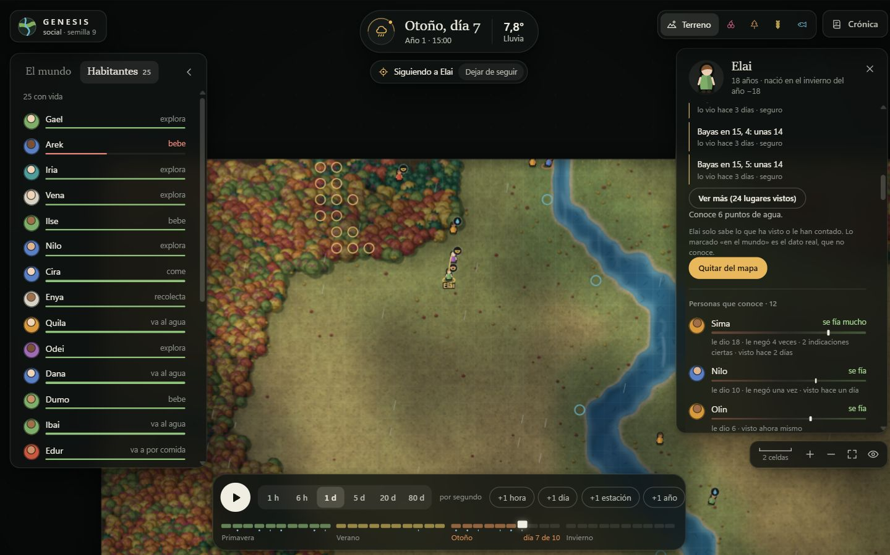

# GENESIS F2 — Estado de entrega

Versión **0.2.0-f2**. Cierre comprobado el 11/11/2026 en Windows 11,
Python 3.14.4, Intel Core i5-14400F. El alcance es el de `F2-PROMPT.md`.

## Qué funciona

- Memoria de experiencias reales, recuperación pertinente, consolidación y
  olvido determinista. El registro histórico conserva los episodios olvidados.
- Creencias locales con fuente, antigüedad y confianza; observación que las
  corrige, comprobación de indicaciones y relaciones dirigidas.
- Objetivos con planes cortos, condiciones e interrupciones por urgencia.
  Las razones se guardan al decidir, junto con los recuerdos que pesaron.
- Pedir, dar, negar, aceptar o rehusar e indicar lugares. Proximidad, coste de
  una hora, resolución determinista y transferencias atómicas conservadas.
- Persistencia de mente y plan, continuación exacta, reproducción y reglas
  versionadas. F1 mantiene sus huellas; F0 se abre sin habitantes. `ampliar`
  crea una copia de F1 y registra la activación social desde ese momento.
- Ficha de mente, conocidos y creencias diferenciadas del estado real;
  indicadores sociales y de creencias en el mapa; crónica con rutinas
  agrupadas; participantes y causas enlazados; resumen de todo el salto.

Los módulos principales son `motor/mente.py`, `motor/sociedad.py`,
`motor/planes.py`, `sesion.py`, `visor/estatico/mente.js`, `habitantes.js`,
`app.js` y `mapa.js`, dentro de `genesis/`.

## Cierre del trabajo interrumpido

El motor, la sesión y el visor ya estaban integrados. Se comprobaron las dos
últimas correcciones: continuar hacia un bosque próximo con mal tiempo y
enlazar una devolución de ayuda con el recuerdo que la motiva. No se ha
reimplementado ese trabajo ni cambiado el equilibrio del motor al cerrar.

El cierre añade herramientas reproducibles de medidas y observación,
documentación y capturas actuales. Se comprueba la separación de ficha y zoom
a anchuras de escritorio inferiores a 1500 px. El detalle de una entrega dice comida
entregada, muestra hambre en porcentaje y evita repetir identificadores de
participantes que ya tienen botones propios.

## Pruebas ejecutadas

**259 pruebas Python pasan**, sin errores ni fallos, en 246,738 s.
**5 pruebas JavaScript pasan**, sin fallos. Son 67 y 2 pruebas adicionales,
respectivamente, sobre la base de F1 (192 y 3).

```bat
py -3 -B -m unittest discover -s pruebas -v
node --test pruebas/test_interfaz.mjs
```

También se pueden lanzar con `probar.bat`. Python comprueba comportamiento,
conservación, simultaneidad, urgencias, muerte, olvido, reglas F1/F0,
migración, guardado/carga, reproducción, API, saltos y crónicas extensas.
JavaScript comprueba seguimiento, paginación/cambio de persona, geometría
del mapa y traducción de recuerdos, creencias y relaciones.

### Supervivencia al año

Mismas semillas y configuraciones para ambas reglas; no se rebajaron umbrales.

| Condición | Semillas | F1 con ≥23 vivos | F2 con ≥23 vivos | Media vivos F1 / F2 |
| --- | --- | --- | --- | --- |
| Abundancia 1 | 1–20 | 19/20 | **20/20** | 24,75 / 24,85 |
| Abundancia 0,3 | 1–10 | 9/10 | 8/10 | 23,2 / 23,3 |
| Abundancia 0,12 | 1–10 | 0/10 | 1/10 | 9 / 11,7 |

F2 cumple ≥23 vivos en al menos 18/20 semillas abundantes. En abundancia 0,3
las semillas 4 y 9 quedan en 12 y 21 vivos. En 0,12 los resultados F2 son
23, 10, 8, 1, 16, 20, 7, 6, 8 y 18. La memoria no garantiza sobrevivir ni
mejora todas las semillas respecto a F1.

## Medidas comparables

`f2-medidas.json` contiene muestras y huellas. Para repetirlas sin tocar las
partidas existentes:

```bat
py -3 -X utf8 -B herramientas/medir_f2.py --carpeta mediciones --repeticiones 5 > medidas.json
```

La herramienta conserva bases nuevas en una subcarpeta única. La creación
del mundo queda fuera del tiempo de simulación. Son medidas de este equipo,
sin promesa de resultados iguales en otro.

| Un año, 25 habitantes (mediana de 5) | F1 | F2 | Factor |
| --- | --- | --- | --- |
| Semilla 4, abundancia 1 | 0,495 s | 0,947 s | 1,91× |
| Semilla 1, abundancia 1 | 0,618 s | 0,973 s | 1,57× |
| Semilla 9, abundancia 0,3 | 0,548 s | 0,980 s | 1,79× |

- Semilla 1 F2 durante seis años: cada año entre 0,922 y 1,002 s, de 2563 a
  14943 eventos. Las decisiones usan el estado activo, sin consultar toda la
  historia de SQLite.
- Memoria Python con `tracemalloc`, semilla 1 al año: F1 10,68 MB; F2
  12,70 MB (picos 10,70 y 12,73 MB). Son asignaciones Python trazadas, no la
  memoria total del proceso. Mente serializada media: 5019 bytes/persona.
  Estado JSON completo: 100832 frente a 226472 bytes. Memoria activa medida:
  3–13 recuerdos/persona; el repaso diario deja como máximo 32 y el motor
  comprueba un límite transitorio de 68.
- Base SQLite al año: 569344 bytes F1 / 643072 F2; a cinco años:
  2318336 / 2740224 bytes, después de guardar y cerrar el WAL.
- Consulta de ficha a cinco años (40 consultas rotando por 25 personas):
  mediana 1,329 ms F1 / 1,955 ms F2; máximos 1,667 / 2,765 ms.
  Lista, estado, crónica y resumen: medianas F2 inferiores a 0,5 ms.
- Salto de un año con guardado: 1,15 s F1 / 1,53 s F2. Continuar del año 1
  al 5 (cuatro años): 3,96 / 5,91 s. Consultas combinadas ficha/lista durante
  ese segundo salto: máximo observado 23,38 / 38,44 ms.

## Revisión jugable y visual

Se usaron partidas nuevas de prueba, con código actual, además de la suite.
Se revisaron una semilla abundante (4) y la semilla 9 con abundancia 0,3:
objetivo y recuerdo de Elai, su devolución a Zael, creencias y conocidos,
filtros y rutinas desplegables, participantes, avance exacto de una hora,
marcha/pausa, seguimiento y resumen social de un año. Un salto de 20 años
iniciado por la API se canceló con el botón del visor a los 2,4 años;
mostró el intervalo realmente calculado y el resumen parcial.

Se comprobaron marcos de **1280×720, 1440×900 y 1920×1080**, con diferencias
inferiores a un píxel por redondeo del navegador. En los dos menores la ficha
termina 12 px por encima del zoom; en el mayor hay 16 px de separación.
El cuerpo de la ficha se desplaza para alcanzar todos sus bloques.
No se ha validado la experiencia móvil.

### Fluidez observada frente a F1

Mismo visor, semilla 4, 25 habitantes, abundancia 1, inicio en hora 0,
seguimiento de Beto, 1440×900. Cada mundo avanzó unos 62 s a 6 horas/s y
después 81 s (F1) / 91 s (F2) a 24 horas/s. Se midieron ventanas móviles de
hasta 1200 redibujados mediante una envoltura de observación del mapa,
sin modificar el motor. La suite ya había terminado.

| Muestra | Redibujados/s F1 / F2 | Coste p95 de dibujo F1 / F2 | Intervalo p95 entre cuadros F1 / F2 |
| --- | --- | --- | --- |
| 6 horas/s | 76,2 / 53,1 | 2,1 / 5,5 ms | 49,9 / 116,7 ms |
| 24 horas/s | 25,5 / 63,5 | 7,8 / 2,9 ms | 154,5 / 77,9 ms |

Son muestras orientativas, no una clasificación de rendimiento entre
versiones: las conductas, la zona vista, el clima y la reutilización del
dibujo cambian a lo largo de la partida. Los promedios no eliminan los
tirones que muestran los percentiles. El coste del motor se compara por
separado con cinco repeticiones en la tabla anterior.

El registro del navegador incluyó tres mensajes `MutationObserver` sin
archivo de origen. No hay usos de esa API en el proyecto; no se ha atribuido
ese aviso a la simulación. La revisión no equivale a una consola global libre
de errores. No apareció un error de simulación en la sesión.



Las [cadenas causales](F2-CADENAS.md) incluyen ejecuciones libres y pruebas
controladas, identificadas por separado. Hay reciprocidad espontánea de
comida y de información; no se han añadido historias para producirla.

## Límites y continuación

- La reciprocidad es rara y en abundancia hay pocas peticiones. La escasez
  crea más oportunidades, pero también mantiene a muchos sin excedentes.
- Las negativas cambian decisiones en pruebas controladas; no se observó la
  cadena negativa → relación peor → nueva elección en la semilla libre 9.
- Los habitantes conocen la geografía de bosque, pradera y río; desconocen
  existencias remotas, recuerdos ajenos y relaciones que no han vivido.
- Comida e indicaciones son el catálogo social de F2. No hay lenguaje,
  reputación global, grupos, generaciones ni deliberación con modelos.
- La fluidez depende de clima, cámara y velocidad; no se promete una tasa
  fija de cuadros por segundo. El determinismo se ha comprobado en este
  equipo y entre procesos, no entre otros sistemas o versiones de Python.

F2 queda cerrada dentro de ese alcance. La siguiente fase debe partir de esta
base verificada y medir las nuevas conductas sin modificar las reglas de
partidas antiguas. El alcance de F3 se definirá por separado.
