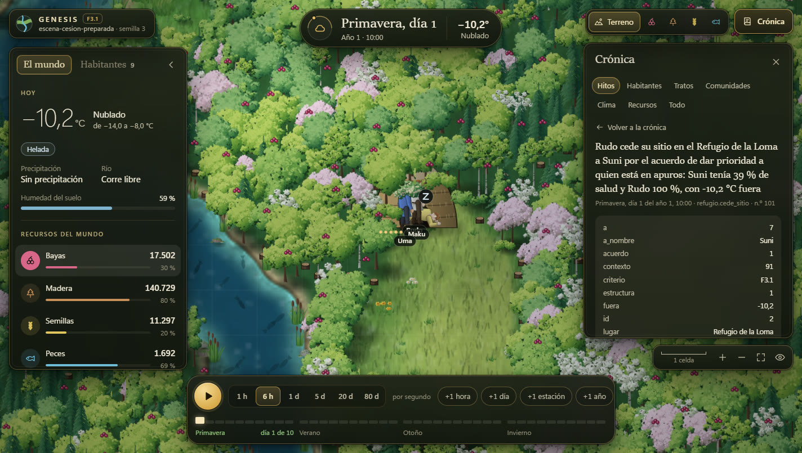
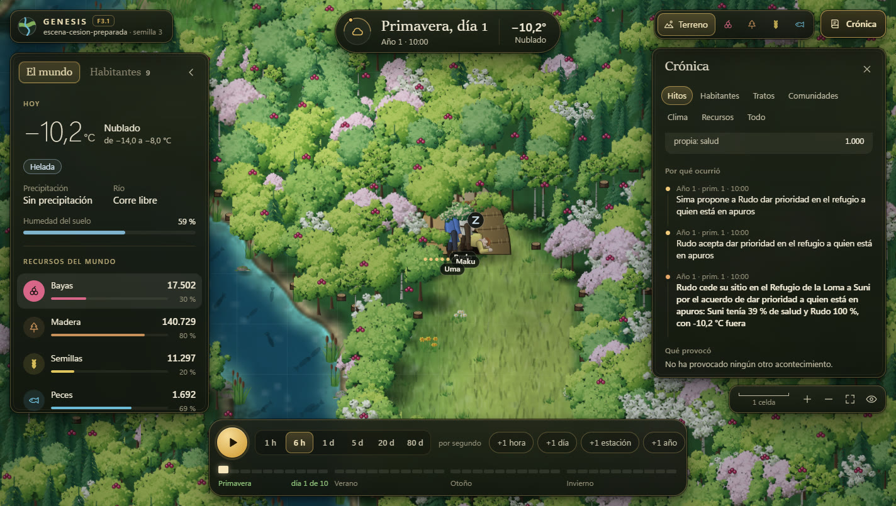

# GENESIS F3.1 — Cesiones de sitio con razón y causa fiel

Corrección acotada de F3 (13-11-2026). Diario: [F3.1-ESTADO_DESARROLLO.md](F3.1-ESTADO_DESARROLLO.md).
Los resultados históricos de F3 siguen en [F3-ESTADO.md](F3-ESTADO.md).

## 1. Qué se ha corregido

**Defecto 1 — cesiones de ida y vuelta.** En F3 contaba como «en apuros»
cualquiera expuesto al frío, y cedía el sitio cualquier ocupante sano que
aceptara el acuerdo. Dos personas igual de sanas y expuestas al mismo frío
podían pasarse la plaza en la misma hora sin que nadie ganara nada.

**Defecto 2 — causa equivocada.** El suceso de la cesión apuntaba como causa a
la última novedad del refugio (su terminación o una reparación); el acuerdo
solo figuraba como dato.

### El criterio nuevo, en breve

Si queda una plaza, se ocupa: nadie es desplazado. Con el refugio lleno, alguien
de dentro deja su sitio solo si se cumple todo esto, con lo que cada uno puede
ver o sabe:

1. Fuera hay un **peligro real**: frío por debajo del umbral de daño (−3 °C),
   contando la lluvia.
2. Quien llega está **mal de verdad**: salud por debajo de 500. Estar expuesto
   al frío no basta, porque todos los de fuera lo están igual.
3. Quien llega **no tiene otra alternativa** al alcance: ni bosque contiguo que
   le baste, ni otro refugio útil a 3 celdas o menos que, por lo que sabe,
   tenga sitio.
4. Quien cede está **claramente mejor**: salud de 700 o más y al menos 300 por
   encima de quien llega, energía de 300 o más y sin hambre grave.
5. Quien cede tiene **una razón que conoce**: el acuerdo de prioridad para
   quien está en apuros, aceptado por él (o propuesto por él), o una ayuda que
   le debe a quien llega y aún recuerda.
6. **Nada vuelve atrás en la misma hora**: quien acaba de recibir sitio no lo
   cede, ni se devuelve una plaza a quien la acaba de ceder.

Entre quienes cumplen, cede quien está mejor (salud, luego energía, luego
identificador). Las peticiones de la misma hora se resuelven en el orden de
turno, siempre igual. Al ejecutarla se comprueba que quien cede sigue dentro,
vivo y en ese refugio. Quien cede queda fuera con su objetivo marcado para
replanificar (no espera a la puerta). Muerte, salida voluntaria o una plaza
que se libera siguen funcionando como en F3; si cambian las circunstancias
(alguien empeora fuera y otro se ha repuesto dentro), la ocupación puede
reconsiderarse con el mismo criterio.

El margen de 300 de salud evita la alternancia: tras una cesión, la persona
que ha entrado estaba por debajo de 500, así que la que salió no puede
reclamar el sitio mientras no esté ella mucho peor.

### La causa registrada

`refugio.cede_sitio` (con `criterio: "F3.1"`) enlaza ahora como causa:

- con un acuerdo: **la aceptación de ese acuerdo por quien cede** (o su
  propuesta, si lo propuso él). Esa aceptación se anota en su mente en el
  momento de aceptar (`aceptado_en`); si lo conoció antes de F3.1, se usa el
  suceso del acuerdo que conoce;
- con una ayuda recordada: el suceso real de esa ayuda (`habitante.da`), si
  conserva el recuerdo.

Guarda además `motivo`, `acuerdo`, `origen`, la salud y energía de quien llega
(`necesidad`) y de quien cede (`propia`), la temperatura de fuera y, aparte,
`contexto`: la última novedad del refugio, que ya no se toma como causa. Si
nadie tiene una razón conocida, no hay cesión: no se cita un acuerdo que no se
conoce ni se inventa un vínculo.

Los sucesos antiguos no se reescriben: las cesiones de partidas F3 siguen con
su causa de entonces, y la herramienta las presenta como sucesión.

## 2. Compatibilidad y reproducción

- La regla tiene versión: `ConfigHabitantes.correccion` (0 = F3, 1 = F3.1) y
  `activacion_correccion`. Una configuración guardada sin el campo se carga con
  0, así que **toda partida F3 anterior se repite con su criterio**.
- El estado nuevo solo aparece con la corrección activa (lista de cesiones
  recientes, hora de aceptación de un acuerdo): las partidas F3 conservan sus
  huellas.
- Partidas nuevas: F3.1. `iniciar.bat` abre por defecto la partida F3.1 más
  reciente; si la semilla ya tiene una F3 anterior, la nueva se llama `-f31`.
- `ampliar` sobre una F3 anterior crea `NOMBRE-f31` con la corrección activa
  desde la hora de la copia y el suceso `refugio.criterio_cesion` en la primera
  hora nueva; la meta `etapas` lo anota. F1 y F2 se amplían ya con F3.1.
- La partida de desarrollo «aldea» (`docs/f3/partidas-desarrollo/`) mezcla
  políticas de F3 anteriores a su cierre; no se usa para exigir reproducción.

Comprobado con el código de F3.1 (verificar = repetir desde la semilla y
comparar sucesos y estado):

| Partida | Creada con | Resultado |
| --- | --- | --- |
| `r2` (F2, semilla 5, 1920 h) | código de F3 | Reproducción exacta |
| `r3` (F3, semilla 5, 1920 h, 9036 sucesos) | código de F3 | Reproducción exacta, con el criterio de F3 |
| `aldea-inicio` (F3, semilla 3, 960 h) | código de F3 | Reproducción exacta |
| `s8-f31` (F3.1, semilla 8, recursos 0,3, 1080 h) | código de F3.1 | Reproducción exacta |
| `r3-f31` (copia ampliada de `r3` a la hora 1920, +480 h) | `ampliar` de F3.1 | Reproducción exacta: 1920 h con el criterio de F3 y 480 con el de F3.1; `refugio.criterio_cesion` en el suceso 9037, hora 1921 |
| `r3` tras la copia | — | Sigue reproduciéndose: no se ha modificado |

Además, en las pruebas: la semilla 8 escasa con el criterio de F3 produce
exactamente los sucesos 7590 y 7592 del informe original; guardar, cargar y
continuar una partida F3.1 da el mismo estado y registro que no interrumpirla;
y siguen pasando las huellas de F0, F1 y F2 y la cadena F1→F2→F3.

## 3. El caso Juna–Hebe, antes y después

Semilla 8, recursos al 30 %, 25 habitantes, reglas 3, mundo libre, 2 años,
mismas condiciones que la revisión de F3. Reproducible con:

```bat
py -3 herramientas/revisar_f3.py --semillas 8 --abundancia 0.3 --correccion 0 --json antes.json
py -3 herramientas/revisar_f3.py --semillas 8 --abundancia 0.3 --correccion 1 --json despues.json
```

| | Criterio de F3 | Criterio de F3.1 |
| --- | --- | --- |
| Cesiones | 6 | 0 |
| Ciclos en la misma hora | 2 (`7590` Juna→Hebe y `7592` Hebe→Juna, hora 961) | 0 |
| Vueltas en 24 h | 2 | 0 |
| Causa de las cesiones | `3915` (`obra.terminada` del Refugio del Vado) o `12212`: sucesión, no motivo | — |
| Veces sin sitio | 18 | 20 |
| Vivos al año 1 / año 2 | 25 / 19 | 25 / 21 |

Con el criterio de F3, además del par de la hora 961, la plaza siguió rotando
en las horas 962–964 (Juna→Nura, Juna→Beto, Hebe→Juna). Ninguna de esas
personas murió en las 48 horas siguientes. Con F3.1 nadie cede, porque nadie de
los que llegaron al refugio lleno estaba en apuros de verdad: todos tenían
salud alta. Fuentes: [f31/semilla8-escasa-correccion0.json](f31/semilla8-escasa-correccion0.json)
y [f31/semilla8-escasa-correccion1.json](f31/semilla8-escasa-correccion1.json).

## 4. Una cadena causal correcta

Escena preparada (no mundo libre): la de `pruebas/test_cesiones.py`, guardada
como partida con `herramientas/escena_cesion_f31.py` para verla en el visor.
Semilla 3, 9 habitantes, refugio levantado por el motor con madera talada,
parte frío fijado a mano (−14 a −8 °C), primavera del año 1, hora 10.

1. `91` — `obra.terminada`: el Refugio de la Loma queda en pie (es el
   `contexto` de la cesión, no su causa).
2. `92` — `acuerdo.propuesto`: Sima propone a Rudo «prioridad en el refugio a
   quien está en apuros».
3. `93` — `acuerdo.aceptado`: Rudo lo acepta. Causa registrada: `92`.
4. `101` — `refugio.cede_sitio`: Rudo cede su sitio a Suni, que llega con salud
   393 (Rudo, 1000), con −10,2 °C fuera. **Causa registrada: `93`**, su propia
   aceptación del acuerdo; `contexto: 91`.

El visor cuenta lo mismo: en la crónica, «Por qué ocurrió» muestra la
propuesta, la aceptación y la cesión.




Las pruebas comprueban también que una cesión por una ayuda recordada enlaza
el suceso de esa ayuda y no cita ningún acuerdo, y que un acuerdo que la
persona no conoce no se cita ni la hace ceder.

## 5. Pruebas

- Python: **301 pruebas, OK** (282 de F3 + 19 nuevas), 488,7 s. Registro:
  [f31/registro-suite-final.txt](f31/registro-suite-final.txt), con el código
  final salvo el número de versión (`0.3.1-f31`), que se cambió durante la
  ejecución; las pruebas que lo usan (almacén, sesión y servidor, y cesiones,
  58 en total) se repitieron después: OK. Los dos avisos de conexión SQLite
  sin cerrar que aparecen en el registro ya estaban en el de F3.
- JavaScript: 13 pruebas, OK (1 nueva: la frase de la cesión dice su motivo).
- `pruebas/test_cesiones.py` (19, escenas controladas salvo las dos de mundo
  libre): dos expuestos al mismo frío no se intercambian la plaza (y con el
  criterio de F3 sí, como prueba del defecto); quien está mucho peor recibe una
  cesión justificada; una plaza libre se usa sin expulsar a nadie; sin peligro
  fuera nadie es desplazado; varias solicitudes simultáneas se resuelven igual
  siempre; la cesión no se revierte al turno siguiente; un cambio real permite
  reconsiderar; salida y muerte liberan la plaza; quien cede replanifica y todo
  cuadra durante horas; la cesión por acuerdo enlaza la aceptación de quien
  cede; quien lo propuso cita su propuesta; un acuerdo desconocido no se cita;
  una cesión por ayuda no recibe causa de acuerdo; sin acuerdo ni ayuda nadie
  cede; semilla 8 con el criterio de F3 reproduce 7590 y 7592; con F3.1 no hay
  ciclos y guardar y cargar no cambia nada; una F3 anterior se reproduce y su
  copia ampliada activa el criterio nuevo; una partida nueva usa F3.1.
- Antes de corregir fallaban 10 de esas 19:
  [f31/pruebas-antes-de-corregir.txt](f31/pruebas-antes-de-corregir.txt).
- Ajuste en una prueba existente: la de cesión de `test_comunidad.py`
  comprobaba el criterio de F3; ahora fija `correccion=0` para seguir
  comprobándolo (lo usan las partidas F3).

## 6. Mundos libres y supervivencia

Revisión de F3.1, mismas condiciones que la de F3 (10 semillas × 2 años):

| | Vivos año 1 / 2 | Obras inic. / term. | Comunidades (funcionales) | Acuerdos propuestos | Veces sin sitio | Cesiones |
| --- | --- | --- | --- | --- | --- | --- |
| Abundante, F3 | 247 / 238 | 133 / 124 | 67 (57) | 15 | 86 | 10 |
| Abundante, F3.1 | 247 / 238 | 134 / 125 | 68 (57) | 16 | 134 | 0 |
| Escasa, F3 | 239 / 196 | 124 / 115 | 52 (44) | 15 | 43 | 10 |
| Escasa, F3.1 | 239 / 198 | 124 / 115 | 51 (44) | 17 | 48 | 0 |

Las veces sin sitio suben (de 86 a 134 en abundancia, de 43 a 48 en escasez):
quien antes entraba por un intercambio con alguien igual de sano ahora se queda
fuera y busca otro abrigo. La supervivencia no cambia en abundancia y mejora
en 2 personas en escasez; con estos tamaños de muestra, ambas diferencias están
dentro de lo que cambia una sola decisión en una semilla.

Fuentes: [f31/revision-abundante.json](f31/revision-abundante.json),
[f31/revision-escasa.json](f31/revision-escasa.json); las de F3, en `docs/f3/`.

**Supervivencia exigida** (≥ 23 de 25 vivos al año en ≥ 18 de 20 semillas
abundantes): **19 de 20 con F3.1**, igual que con F3; la semilla 4 queda en
22. [f31/supervivencia-20-semillas.json](f31/supervivencia-20-semillas.json).
Escasez a 2 años, 10 semillas: 239/196 (F3) frente a 239/198 (F3.1)
([f31/supervivencia-escasa.json](f31/supervivencia-escasa.json)).

**¿Han desaparecido las cesiones?** En los mundos libres revisados, sí:
ninguna cesión con F3.1. Para saber si eso es el criterio fallando o el caso
justificado sin presentarse, se instrumentó la decisión (sin cambiarla):

- En los 20 mundos de la revisión (2 años) hubo 269 peticiones de sitio en un
  refugio lleno; en 216 no había peligro fuera, y en las 53 con peligro quien
  llegaba tenía salud de 600 o más (49 de ellas, 900 o más). Ninguna cumplía la
  condición de necesidad.
- Repitiendo esos 20 mundos con el criterio de F3 y anotando la salud de ambos
  en cada cesión: en las 20, quien recibía tenía entre 807 y 1000 de salud y
  quien cedía entre 799 y 1000. Eran intercambios entre personas sanas.
  [f31/cesiones-f3-salud.json](f31/cesiones-f3-salud.json).
- Búsqueda amplia con `herramientas/buscar_cesiones.py` (60 semillas × recursos
  al 100 %, 30 % y 12 % = 180 mundos libres, 3 años cada uno): **2118**
  peticiones de sitio en un refugio lleno con peligro fuera; **una sola** de
  alguien en apuros (Neva, salud 393, −6,4 °C, semilla 12 al 30 %, hora 700, ante
  seis ocupantes con salud de 990 o 1000), en una comunidad **sin** el
  acuerdo y sin ayuda recordada: nadie tenía una razón conocida para cederle el
  sitio, y nadie lo cedió. **0 cesiones** en total.
  [f31/busqueda-cesiones.json](f31/busqueda-cesiones.json).

Conclusión: el criterio cede cuando el caso se da (lo prueban las escenas
controladas y la captura), y en los mundos libres revisados el caso
justificado casi no aparece. No se ha rebajado el criterio para que salgan
cesiones ni se han añadido recursos.

## 7. Límites

- **Cesiones casi inexistentes en mundos libres.** Es la consecuencia honesta
  del criterio: llegar enfermo a un refugio lleno en pleno frío, con alguien
  dentro que conoce el acuerdo, casi no ocurre. El acuerdo «prioridad para
  quien está en apuros» apenas tiene efecto práctico en estos mundos.
- **Umbrales fijos.** Salud 500 / 700 / margen 300 y 3 celdas son parámetros de
  juego, no medidas; están en el código del criterio, no en la configuración.
- **Lo que «sabe» quien cede.** Se supone que ve el estado de quien llega
  (salud aparente). No modela que alguien finja ni que se equivoque.
- **Sin cambios en los límites de F3**, que siguen como estaban:
  - los refugios no tienen agua, y salir a beber durante un frío extremo mata;
  - los acuerdos son poco frecuentes (15–17 propuestas en 10 mundos y 2 años);
  - la gente se fragmenta en comunidades pequeñas (unas 5 personas);
  - el coste de simular crece con la historia.
- Los sucesos de F3 no se reinterpretan en el registro: sus cesiones siguen
  apuntando a su causa de entonces; las herramientas las marcan como sucesión.
